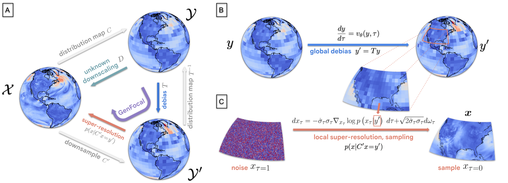
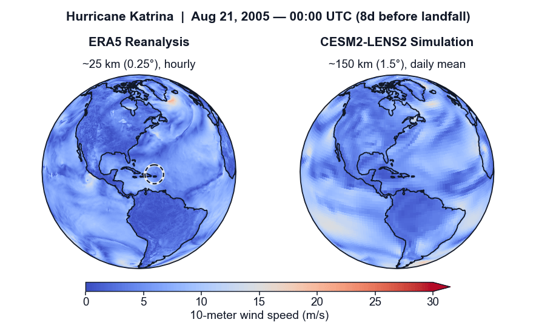
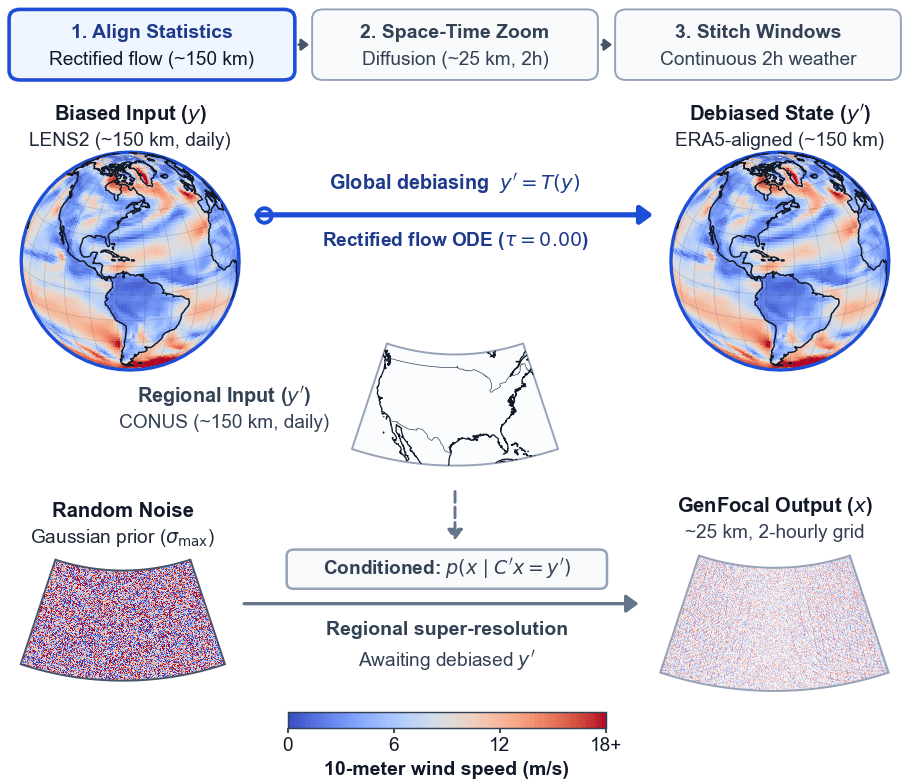
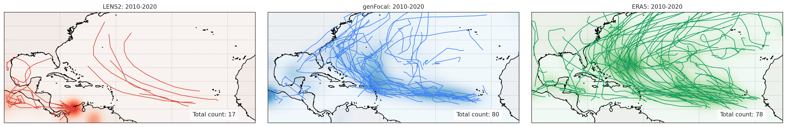
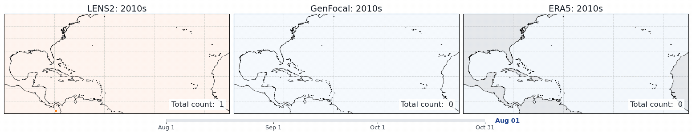
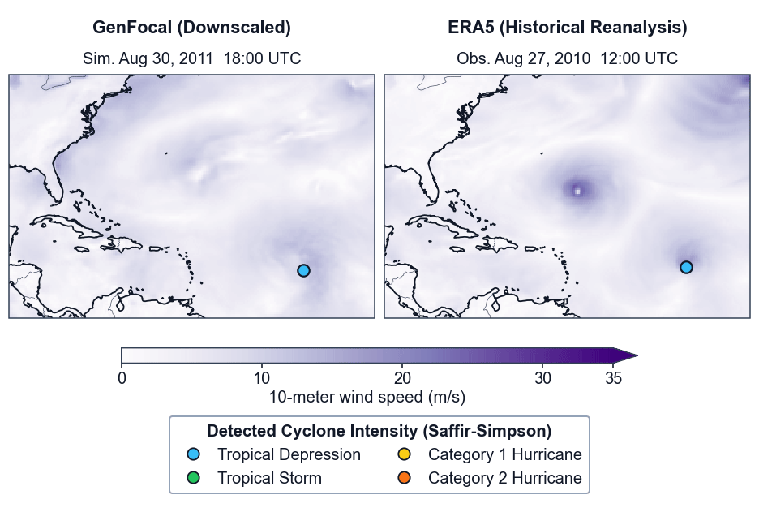

# Regional climate risk assessment from climate models using probabilistic machine learning



This package contains example code to run downscaling models described in the
*Nature Machine Intelligence* paper
[Regional climate risk assessment from climate models using probabilistic machine learning](https://www.nature.com/articles/s42256-026-01308-7)
([arXiv:2412.08079](https://arxiv.org/abs/2412.08079)).

Code for the debiasing stage can be found in the `debiasing/` sub-folder and
code for the super-resolution stage can be found in the `super_resolution/`
sub-folder.

## Installation

To make the installation seamless we use `pip`. Although the installation should
work on any Linux-based system, we strongly recommend using a high-memory
GPU, such as a `A100` (80GB), `H100`, `B100`, or a `TPU v5p`. We also recommend
using `python=3.12`.

1. Create a virtual environment.

```bash
python3 -m venv genfocal
```

2. Activate the virtual environment

```bash
source genfocal/bin/activate
```

3. Install jax with the accelerator support that matches your system. If you
have a GPU then, following jax installation [instructions](https://docs.jax.dev/en/latest/installation.html#),
you can type

```bash
pip install -U "jax[cuda12]"
```

4. Install `swirl-dynamics`. This will install all the
[basic required dependencies](https://github.com/google-research/swirl-dynamics/blob/main/pyproject.toml),
as well as genfocal. Here we assume that you have `git`
already installed in your system.

```bash
pip install git+https://github.com/google-research/swirl-dynamics.git@main --quiet
```

5. Clone the repository to your machine.

```bash
git clone https://github.com/google-research/swirl-dynamics.git
```

The training and inference routines are written to work in a single accelerator,
multiple accelerator, or multiple replica (several nodes) regimes.
These capabilities are accessed via a flag in the configuration files. We
recommend to use multiple accelerators for training and inference.

## Repository Structure

The repository is organized as follows:

```
genfocal/
├── analysis/
├── data/
├── debiasing/        # contains the code for the bias-correction step.
│   ├── colabs/       # demo for debiasing.
│   ├── configs/      # examples configuration files.
│   └── figures/      # figures for the readmes and notebooks.
├── evaluation/       # contains example evaluation scripts.
├── figures/
└── super-resolution/ # contains the code for the super-resolution step.
    └── colabs/       # demo for super-resolution.
    └── configs/      # example configuration files.
```

The repository is organized into two primary folders for the debiasing and
super-resolution steps. Each folder contains a `colabs` subfolder with
corresponding demos.

The `data` folder includes notebooks for loading and visualizing the data.

The `analysis` folder contains the code to reproduce the analysis in our paper.
Note that running the full evaluation pipeline is computationally expensive due
to its reliance on `TempestExtremes` and terabytes of data. Therefore, we
provide notebooks to reproduce the figures and the source code for the more
intensive analyses.

## Workflow

As GenFocal has two distinct steps the workflow is also split in two. Each step
is specified in the README files inside the corresponding folders
(`debiasing/README.md` and `super_resolution/README.md`).

Free-running global climate simulations (~150 km, daily mean) evolve along
independent internal weather timelines with no calendar-date correspondence to
historical reanalysis (~25 km, hourly ERA5) and smooth out localized hazards:



*Surface wind speed from August 21 to 31, 2005 around Hurricane Katrina's Gulf
Coast landfall in historical ERA5 reanalysis (~25 km, hourly, left) versus a
free-running CESM2-LENS2 climate simulation (~150 km, daily mean, right) on the
same calendar dates.*

GenFocal addresses this date-unpaired downscaling problem in three stages:

1.  **Unpaired distribution debiasing (`debiasing/`)**: A global Rectified Flow
    model aligns the distribution of coarse daily (1.5°, ~150 km) CESM2-LENS2
    fields to coarsened ERA5 without pairing calendar dates (y → y').
2.  **Spatiotemporal super-resolution (`super_resolution/`)**: Conditioned on
    the debiased regional climate sequence y', a conditional diffusion model
    sharpens daily fields onto a 0.25° (~25 km), 2-hourly regional grid.
3.  **Continuous multi-day trajectory stitching
    (`super_resolution/sampling.py`)**: Adjacent multi-day diffusion windows are
    synchronized across 1-day overlaps in parallel (`jax.lax.ppermute`) to form
    seamless multi-week and seasonal trajectories (x) while recovering mesoscale
    spatial and diurnal temporal spectra (`evaluation/spatial_spectra.py`,
    `evaluation/temporal_spectra.py`).



*Three-stage GenFocal pipeline illustrated on five consecutive August 2018
summer days over North America: global Rectified Flow debiasing (y → y'),
conditional diffusion super-resolution to 0.25° (~25 km), and multi-day
overlapping window stitching into continuous 2-hourly trajectories (x).*

## Tropical Cyclones

Below we show one of the main results in the paper, which shows the tracks and
their corresponding ensemble density, for the biased climate dataset (LENS2),
its downscaled version given by GenFocal, and the reference given by ERA5 over
the out-of-sample 2010–2019 test period.





*Ten years (2010–2019) of August–October North Atlantic tropical cyclone tracks
evolving simultaneously by calendar day across a raw CESM2-LENS2 simulation (17
storms), a GenFocal downscaled realization (80 storms), and historical ERA5
reanalysis (78 storms), overlaid on full-ensemble track density (100 LENS2
members, 800 GenFocal realizations, and ERA5).*



*Seven-day, 2-hourly evolution of a synthetic Category 2 North Atlantic
hurricane generated by GenFocal from coarse daily LENS2 inputs (left) alongside
a comparable historical storm in ERA5 reanalysis (Hurricane Earl, right).*

## License

Licensed under the Apache License, Version 2.0.
